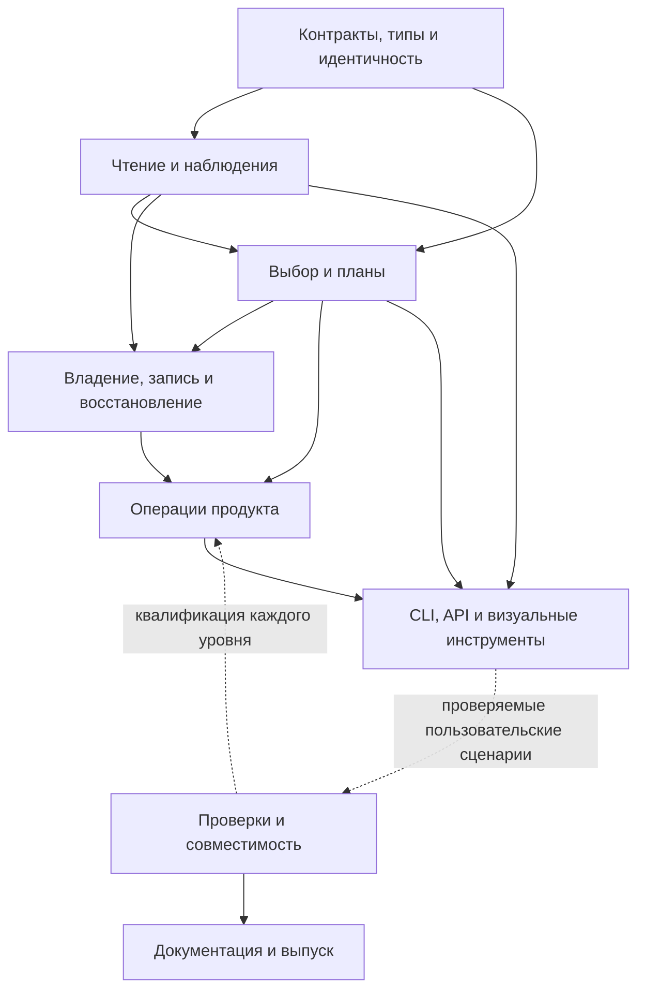

# Архитектура всего плана VibeVM NEXT

Карта охватывает **все222исходных записи задач**:113принятых в восстановленном плане Zap и109непринятых. Она не заменяет проверку реализации. Из113принятых аудит исходников отметил93реализованных в рассмотренных границах,18частичных и2неустановленных; по всем222 —95/49/72/6. Наличие цвета прототипа не означает перенос в main. Подтверждённый нижний предел полностью перенесённых старых задач —1(M-01-A.3); остальные соответствия имеют отдельный статус.

- [Полная таблица222задач](TASKS.md).
- [Машиночитаемая карта](map.json): capabilities, hard/interface/gate links, подчасти, исходные критерии/неопределённость и main owners.
- [Проверенные ссылки на исходники](source-evidence.json):91проверенный pinned hash entry; хеш подтверждает идентичность прочитанных байтов, не корректность непрочитанного кода.
- [Основания64](foundations-review.md), [runtime81](runtime-review.md), [изменения/API/приёмка77](coordination-review.md): границы прочтения и обоснование каждой части карты.
- Интерактивное представление: `/fast/vibevm-architecture/index.html`. Реальный Chromium/CDP:16проверок прошли на1440px/390px,0ошибок JavaScript/консоли и0внешних запросов страницы. Проверены фильтры, поиск, клавиатура, зависимости,18функций и тёмная тема; root просмотрел desktop/mobile снимки. Временный renderer закрыт, его профиль удалён.

## Крупные уровни

| Уровень | Задач | Из113прототипа | Назначение |
|---|---:|---:|---|
| Контракты, типы и идентичность | 27 | 20 | Единый смысл данных, конфигурации, ролей и версий; чистые правила без запуска действий. |
| Надёжное чтение и наблюдения | 26 | 18 | Точные байты, состав файлов, исходные документы, позиции и снимки состояния. |
| Вычисление и планирование | 20 | 9 | Решение зависимостей, выбор вариантов, сравнение и план изменений до записи. |
| Изменения, владение и восстановление | 41 | 21 | Проверенные записи, поколения операций, продолжение и честный результат частичного сбоя. |
| Полезные операции продукта | 24 | 10 | Установка, обновление, создание изменений, развёртывание клиентов и окружений. |
| CLI, API и визуальные инструменты | 16 | 12 | Доступ человека и внешних клиентов к настоящим операциям и общим представлениям. |
| Проверки и совместимость | 50 | 19 | Исходные аудиты, сценарии, платформенные и сквозные доказательства. Отдельная сопровождающая линия. |
| Документация и выпуск | 18 | 4 | Пользовательские инструкции, учёт изменений, миграционные руководства и разрешённая публикация. |

Основные слои L0–L5 — зависимости по смыслу. Q и R — сопровождающие линии проверок/выпуска, а не универсальный prerequisite любого парсера. Конкретную очерёдность задаёт требуемая capability/подчасть, не номер M-группы и не один слой целиком.

Это обзор потоков, не замена точного графа задач. В объединённой проекции287обязательных capability-связей и313интерфейсных ссылок; все цели существуют, обязательная task-проекция ациклична. Интерфейсная ссылка требует нужный контракт, но не завершение всего будущего runtime задачи. Исторический граф2286расширенных связей сохранён отдельно как исходная гипотеза;99ссылок на внешние permission/resource/docs gates не превращены в новые задачи. Четыре scope-specific вопроса M17↔external bridge evidence явно оставлены до выбора конкретного external-периметра; они не блокируют независимое ядро. M16-C.2 и четыре уточняющие C.2.* записи входят в старый знаменатель вместе:222 — не число строгих листьев дерева.

## Фундамент, скрытый в поздних задачах

1. **M-13-C.1:** сохранение синтаксиса/комментариев, точный план и NeedsInput нужны рано. Конкретные feature/source/Redbook recipes содержат реальные зависимости на свои readers и интегрируются с ними; полный guarded apply M-13-D.1 нужен при записи, не для чистого чтения.
2. **M-14-A/B:** definition/executor/target/domain и ссылки на точные экземпляры нужны конфигурации. Physical grants и deploy M-14-C — следующий уровень. Путь в wire не является полномочием файловой системы.
3. **M-15-A.1/A.3:** идентичность входа/рецепта/результата и проверенный выбор запускаемого артефакта полезны существующим bin consumers раньше HOME/OCI/Arch. Main уже имеет часть record/observation owners; их расширяем, не дублируем.
4. **M-02-C.2, M-11-A/D:** полная выборка фактов и pre/post transition необходимы правкам и проверкам; страница с ограничением количества строк не доказывает полноту. Brownfield promotion и UI не обязательны для самого контракта перехода.
5. **M-16-B/D:** identity/position/snapshot и saved-state/editor preconditions — повторно используемые основы. Полный транспорт, все доменные journals и внешний клиент не должны предшествовать чистому parser/evaluator.
6. **M-17-B.1/A.3:** полный набор принадлежащих проекту ссылок и чтение сохранённых данных без захвата writer могут понадобиться раньше большого rename/API end-to-end.
7. **NEXT-PREVIEW-BASE.2/3:** постоянный формат release records отделён от контроля их заполнения. Счётчик contribution records не является runtime-зависимостью и не доказывает принятие продукта.

## Конкретные функции для пользователей

- **Точно читать нужный исходник** — Получить выбранный раздел или ресурс из нужной версии пакета, с понятной причиной отказа и происхождением текста. (13задач;13из старых113).
- **Вести изменение от общего шаблона** — Создать локальное изменение из пакетного образца, сохранить собственные уточнения и осознанно обновить его происхождение. (9задач;9из старых113).
- **Внести изменение → собрать → проверить** — Продолжить работу над существующим кодом без повторного запуска уже выполненного шага и без подмены доказательств проверки. (11задач;1из старых113).
- **Задавать вопросы и закрывать работу по доказательствам** — Сохранить ответы, явные исключения и решения; отличать прежнее принятие от применимости к нынешнему коду. (10задач;0из старых113).
- **Настраивать пакеты с сохранением своего выбора** — Выбирать варианты, профили и параметры; обновлять и переустанавливать пакет без потери исходных и временно неактивных настроек. (18задач;18из старых113).
- **Читать обычные документы и исследовать boot** — Сохранять README и XML-данные как обычные ресурсы; видеть происхождение текста, причины включения и изменения boot при установке или смене настроек. (18задач;17из старых113).
- **Готовить и безопасно публиковать проверенную сборку** — Проверить точный установленный артефакт, согласовать публикацию и не скрывать частичный результат сбоя внешнего сервиса. (11задач;2из старых113).
- **Подключать разные клиенты агента через пакеты** — Разворачивать инструкции и настройки Claude Code, Codex, OpenCode и Qwen Code с понятным владением и удалением изменений. (11задач;9из старых113).
- **Переиспользовать внешние методики и собственные сценарии** — Переносить ресурсы мостов и применять один замысел функции на разных технологических стеках с явными действиями. (10задач;0из старых113).
- **Делать локальные варианты чужих ресурсов** — Создать собственный вариант документа или дерева файлов, сравнить его с исходником и осознанно обновить базу. (8задач;8из старых113).
- **Подключать существующий проект без потери его смысла** — Осмотреть проект, предложить структуру, применить согласованное изменение и проверить именно новый результат. (11задач;0из старых113).
- **Получить проверенные инструкции и собранный выпуск** — Воспроизвести набор пакетов, пройти документацию и подготовить конкретный пакет публикации; экспорт в tracker только по запросу. (8задач;0из старых113).
- **Мигрировать форматы без ручной порчи файлов** — Посмотреть точный план миграции, сохранить комментарии и значения, применить его с проверкой исходного состояния и восстановлением. (8задач;8из старых113).
- **Явно выбрать, где и для чего выполняется операция** — Различать описание, исполнитель и целевое окружение; не считать строку пути разрешением менять чужой каталог. (7задач;7из старых113).
- **Управлять HOME-окружением, образами и сервисами** — Устанавливать инструменты в поколения окружения, собирать offline rootfs/OCI и безопасно обновлять их. Большая часть пока будущий план. (30задач;0из старых113).
- **Управлять VibeVM из другого приложения** — Получать структурированные модели, вопросы и ход операций, работать с несохранённым текстом и продолжать прерванные действия. (16задач;16из старых113).
- **Навигировать и переименовывать с учётом всего проекта** — Находить точный набор ссылок, согласовывать правки нескольких клиентов, применять переименование и проверять покрытие API. (12задач;0из старых113).
- **Понимать, что изменилось между выпусками** — Получить связанный список изменений, документацию и проверенное руководство миграции, независимые от временного плана. (11задач;5из старых113).

## Порядок текущей интеграции

Карта подтверждает независимость6файлов core meaning/delta и отдельного generic codegen-policy блока. Они первыми проходят самостоятельные gates. Затем подготавливается замкнутый набор canonical schemas/readers; активация новых state writers ждёт всех реальных consumers.

Обнаруженные обязательные связи: новый index4 writer требует совместимого отдельного PATH proxy; optional application-work поля в JSON добавляют обязательные поля Rust-конструкторов и требуют migration producers. Исправление proxy добавляет4пути к исходному201-file candidate (205всего), но не меняет число222исторических задач. Domain state/evaluator/operations и CLI адаптеры разделяются лишь там, где получается самостоятельное работающее состояние без временных заглушек. Полный portability roundtrip — следующий потребитель принятого local configuration и import ownership.

Не нужно ждать весь будущий M15runtime, чтобы перенести его нужные чистые контракты. Не нужно также объявлять весь M15реализованным от переноса этих контрактов. Карта сохраняет и текущую потребность, и будущий горизонт.

## Граница достоверности

Все222ID классифицированы архитектурно; это не полный аудит каждой строки всех исходников. Тела кода проверялись для значимых foundations/спорных связей, остальные строки явно опираются на точные контракты и предыдущий bounded inventory. Свежих runtime-проверок эта архитектурная работа не запускала. Main comparator и prototype pin указаны в map.json; uncommitted core и frozen app candidate не названы принятым main. Перед каждой интеграцией по-прежнему проверяются конкретные исходники, совместимость и реальные сценарии.
